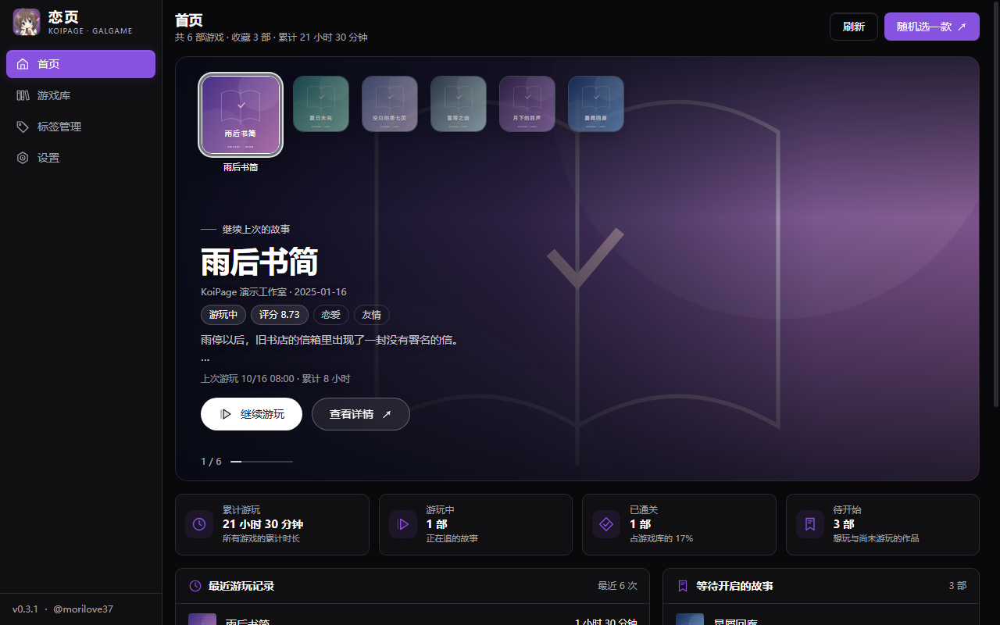
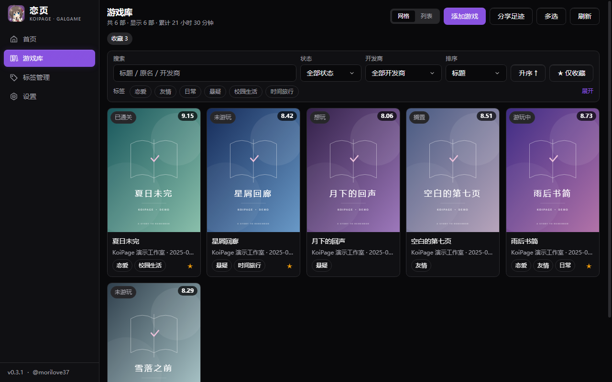
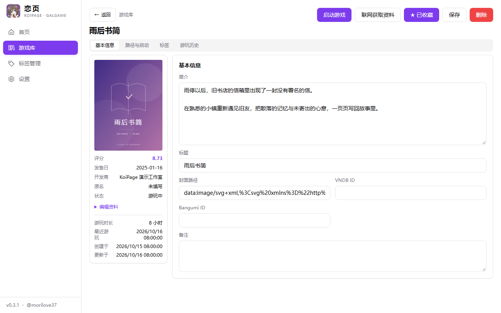
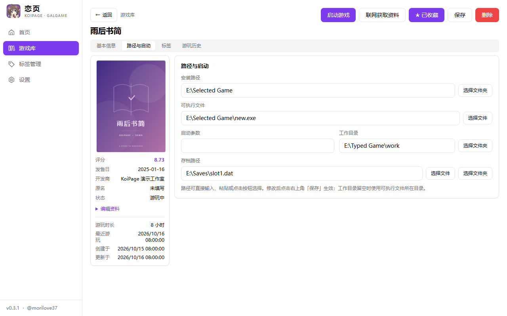
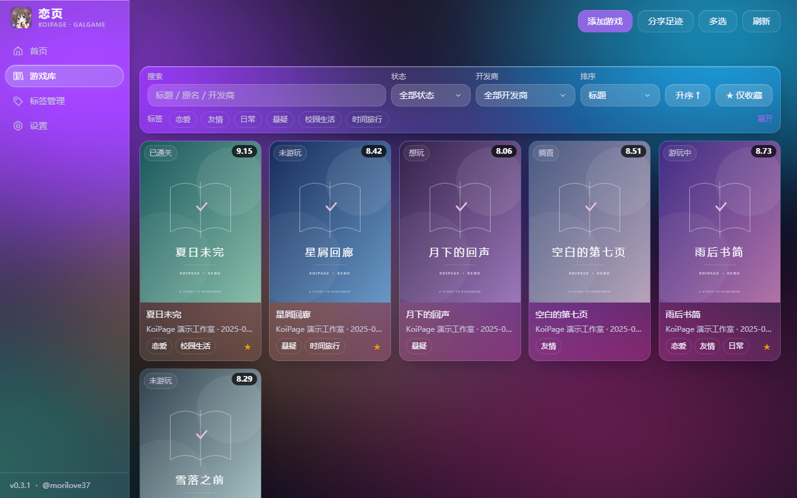
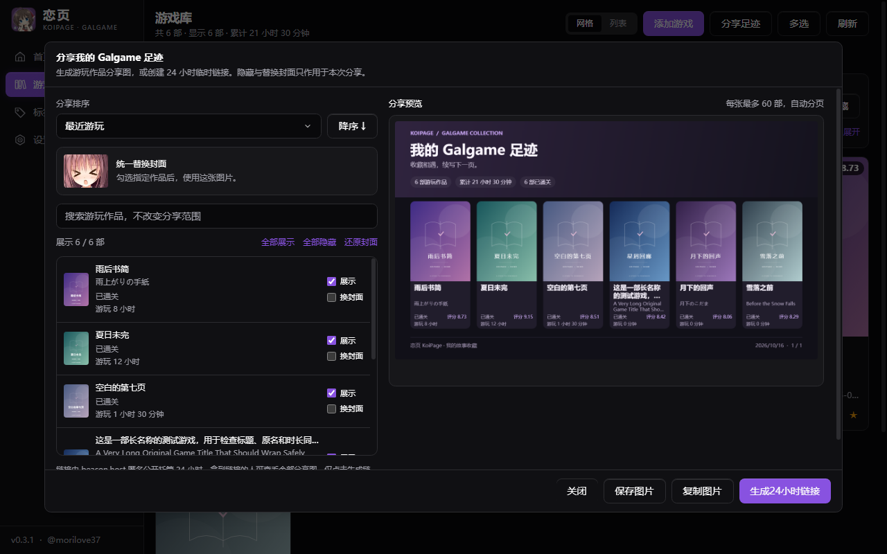

<div align="center">
  

  <h1>恋页 KoiPage</h1>
  <p><strong>收藏相遇，续写下一页。</strong></p>
  <p>为本地 Galgame 与视觉小说收藏打造的 Windows 桌面游戏库。</p>

  <a href="https://github.com/morilove37/KoiPage/releases/latest">下载最新版</a> ·
  <a href="#功能">功能介绍</a> ·
  <a href="CHANGELOG.md">更新日志</a> ·
  <a href="https://github.com/morilove37/KoiPage/issues">反馈问题</a>
</div>

---

把散落在磁盘里的故事，整理成自己的收藏馆。恋页可以扫描游戏、匹配资料、管理标签与收藏、启动游戏并记录游玩时长。下次打开时，从上次的故事继续。

## 下载与安装

前往 **[Releases 下载最新版](https://github.com/morilove37/KoiPage/releases/latest)**，选择 Windows x64 的 `setup.exe` 安装包。也提供 MSI 格式，两种安装包任选一种即可。

- **运行环境**：Windows x64、Microsoft WebView2。
- **普通用户无需安装** Node.js、Rust 或 pnpm。
- GitHub 附带的 `Source code` 是源码，不能直接当作应用运行。
- `latest.json` 与 `.sig` 是更新系统使用的文件，无需手动下载。

## 界面预览

以下为应用实际界面，使用虚构游戏和自制封面演示，不包含个人游戏库。

### 首页：从上次的故事继续



### 游戏库：把收藏整理清楚



### 游戏详情：资料、启动与记录



### 路径与启动：直接选择文件和文件夹



### 液态玻璃：让收藏馆有自己的颜色



### 分享足迹：展示自己的游玩收藏



## 功能

### 导入由你掌控

- **选择 exe 或扫描目录**：根据 exe 的直接父目录整理游戏，同一目录选择一个启动程序。
- **先确认名称**：游戏名使用你提交搜索时填写的名称，数据源标题用于核对作品。
- **两种批量方式**：逐款核对后导入，或一键使用每款搜索结果的第一项；未匹配、失败和未完成项目可继续处理。
- **三源资料匹配**：接入 NextMoe、VNDB 与 Bangumi，补充封面、原名、开发商、发售日、评分、标签和简介。
- **随时手动填写**：找不到作品时可自定义资料；评分按 0–10 保存和显示，精确到小数点后两位。

### 整理自己的游戏库

- 网格／列表视图，标题、原名与开发商搜索，标签、状态、开发商筛选，收藏和多种排序。
- 六种状态：未游玩、想玩、游玩中、已通关、搁置、弃坑。
- 批量选择与删除；删除库记录不会删除磁盘上的游戏文件。
- 标签筛选栏默认一行，可展开；详情里的可选标签也可折叠。
- 点击详情标签，直接定位到标签管理中使用该标签的作品。

### 给每次游玩留下记录

- 首页以主机式封面条与大背景展示作品；滚轮可首尾循环切换，封面、背景和游戏信息同步更新，也可点击封面、拖动浏览或随机挑选一款进入详情。
- 最近游玩记录、累计时长、待玩清单与状态分布。
- 游戏详情提供近期时长柱状图与记录时间线。
- 安装目录、可执行文件、工作目录及存档路径可输入、粘贴或通过文件选择窗口设置，保存后生效。
- 未启用转区工具时，首页和详情页点击启动即直接运行游戏；启用转区工具时保留确认窗口。
- 设置启动参数与可选转区工具；从应用启动的游戏退出后自动结算时长。

### 离线标签汉化

在 **设置 → 资料汉化** 开启。内置 **567 条标签译名**，覆盖题材、人物、剧情、结局与系统功能，无需联网或配置翻译密钥。

汉化只改变显示，原始标签名称与 ID 保留，筛选和跳转继续有效。未收录的内容保留原文，**游戏简介保留原文**。详见 [标签汉化说明](docs/localization.md)。

### 主题与动效

- 浅色、深色、跟随系统与液态玻璃主题。
- **自定义壁纸仅在液态玻璃主题显示**，支持透明度、模糊与填充方式；切换其他主题会隐藏壁纸与壁纸设置，保留已有参数。
- 随主题变色的导航滑块、首页封面切换，以及游戏库进入详情的封面过渡。
- 固定的详情返回与启动操作栏，设置页提供随滚动变化的文字导航。
- 尊重系统的减少动态效果偏好。

### 分享游玩足迹

在游戏库点击 **分享足迹**，可将游玩过的作品生成分享图片：

- 按最近游玩、时长、评分、名称或发售日排序，支持升序和降序。
- 逐款选择是否展示，或使用内置统一替换图遮盖封面；仅影响本次分享。
- 每部作品展示游戏名、原名、评分、游玩状态和累计游玩时长；列表支持使用原名搜索。
- 预览后保存 PNG、复制图片到聊天软件；较大的游戏库自动分页，可一次保存全部图片。
- 点击 **生成24小时链接**，将当前分享图上传到 beacon.host，生成包含全部图片的查看页面；链接由服务方在匿名发布约 24 小时后过期处理。仅显式生成链接时才上传图片，服务有发布频率限制。

没有启动记录但已手动标为游玩中、已通关、搁置或弃坑的作品，也会计入游玩作品。隐藏游戏不会进入图片或汇总统计。

### 数据与更新

- 本地 SQLite 游戏库，支持 JSON／CSV 导入导出与数据库备份。
- **启动时自动检查更新**，也可在 **设置 → 关于** 手动检查。
- 发现新版后展示版本与更新说明，经确认才下载、验证更新签名并安装。
- 游戏仍在运行时会阻止安装更新，避免中断游玩记录。

旧版本没有更新入口时，需要手动安装带更新功能的版本一次，之后即可接收后续版本提醒。

## 快速上手

1. 点击游戏库中的 **添加游戏**，选择 exe 或扫描游戏目录。
2. 确认游戏名称与启动程序，选择逐款确认或一键导入。
3. 核对匹配资料；没有匹配结果时手动填写。
4. 在详情页设置启动信息并启动游戏，退出后查看游玩记录。
5. 在设置中选择主题、开启离线标签汉化，并按需备份游戏库。

## 数据保存在什么位置？

数据库：`%APPDATA%\com.galgame.manager\galgame.db`。

更新沿用同一应用标识和数据库位置。游戏文件仍保存在原目录，封面可使用本地文件或数据源图片。自定义壁纸只读取原图片，不复制或修改。

游戏库保存在本机。**资料匹配会把搜索词发送给所选数据源**；在线封面加载和版本检查也需要网络。离线标签汉化不发送标签或简介。

## 开发与构建

技术栈：**Tauri 2 · Rust · React 18 · TypeScript · Vite · Tailwind CSS · SQLite**。

开发环境需要 Node.js 24、pnpm、Rust stable，以及 Windows 的 MSVC 构建工具、Windows SDK 和 WebView2。

```bash
git clone https://github.com/morilove37/KoiPage.git
cd KoiPage
corepack enable
pnpm install --frozen-lockfile
pnpm tauri dev
```

```bash
pnpm build
pnpm check:ipc
pnpm check:release
cargo test --manifest-path src-tauri/Cargo.toml --lib --locked
```

编译缓存和开发依赖会占用较多磁盘空间，它们不包含在安装包中。更多说明见 [开发文档](docs/development.md) 与 [版本发布流程](docs/publishing.md)。

## 外部资料来源

| 来源 | 用途 |
|---|---|
| [鲲 Galgame 论坛／NextMoe](https://www.kungal.com/) | 游戏资料匹配与多源信息 |
| [VNDB](https://vndb.org/) | 视觉小说资料、标签与评分 |
| [Bangumi](https://bgm.tv/) | 作品资料、中文标签与评分 |

资料和封面归各自权利人所有，使用时应遵守数据提供方的条款。恋页用于管理本机已有游戏，不提供游戏下载。

应用图标为《天津罪／アマツツミ》水无月萤的 Q 版再创作，角色归 Purple software 所有，本项目与原作官方无隶属关系。详见 [图标与角色来源](docs/branding.md)。

## 反馈与作者

遇到问题时，请在 [Issues](https://github.com/morilove37/KoiPage/issues) 提供应用版本、复现步骤和截图，分享前请遮盖个人路径与密钥。

作者：[@morilove37](https://github.com/morilove37)。

项目目前尚未指定开源许可证，第三方依赖及资料遵循各自的许可与使用条款。
