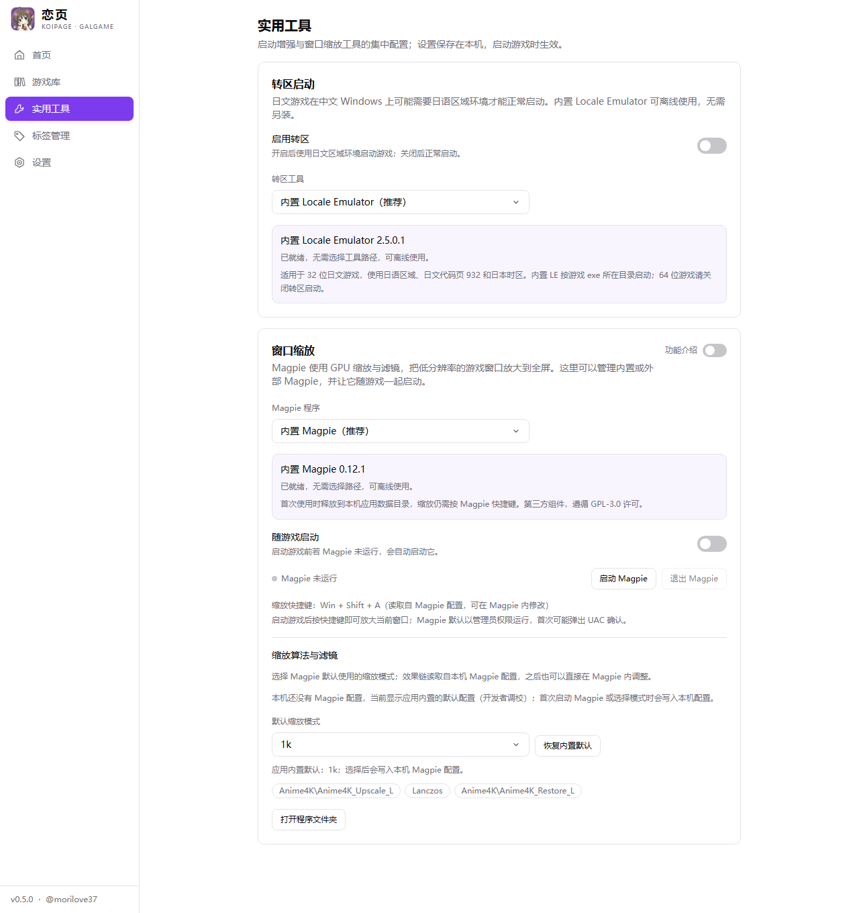
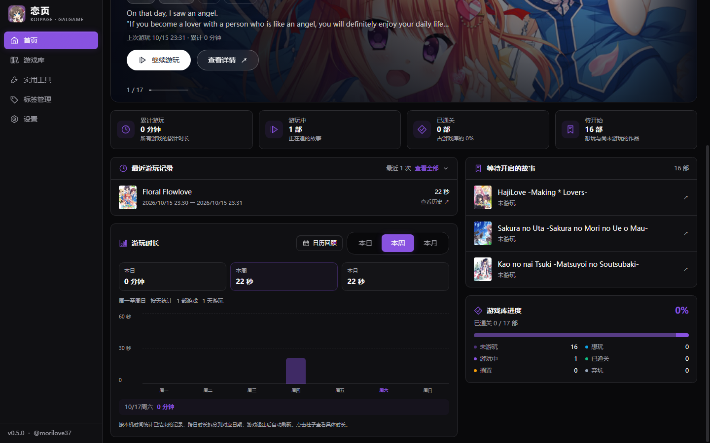
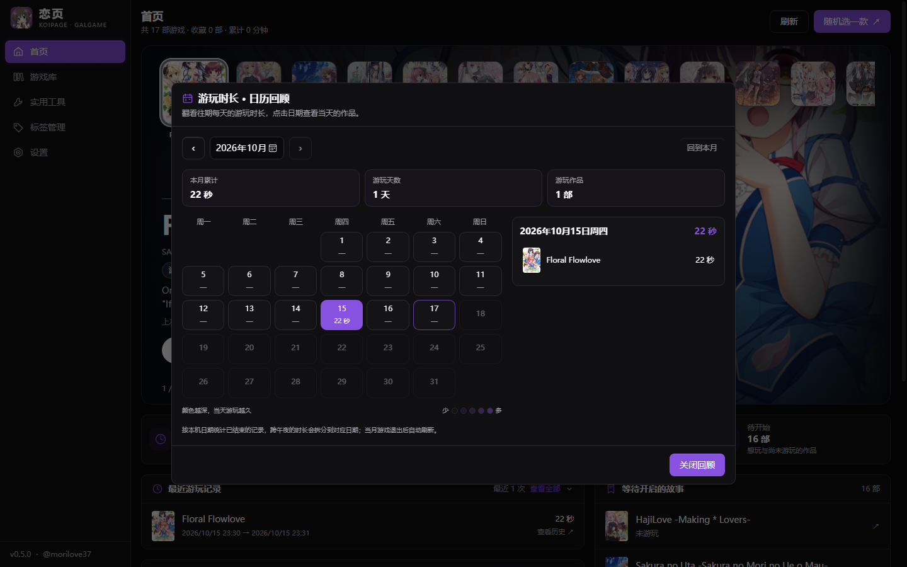

<div align="center">
  

  <h1>恋页 KoiPage</h1>
  <p><strong>收藏相遇，续写下一页。</strong></p>
  <p>面向 Windows 的 Galgame／视觉小说管理器，从整理收藏到继续游玩。</p>
  <p><strong>当前版本：v0.6.0</strong> · Windows x64 · 本地游戏库</p>

  <a href="https://github.com/morilove37/KoiPage/releases/latest">下载最新版</a> ·
  <a href="#界面预览">界面预览</a> ·
  <a href="#功能">功能介绍</a> ·
  <a href="CHANGELOG.md">更新日志</a> ·
  <a href="https://github.com/morilove37/KoiPage/issues">反馈问题</a>
</div>

---

把散落在磁盘里的故事，整理成自己的收藏。**恋页**可以扫描启动文件、匹配作品资料、整理标签与游玩记录，首页还会展示近期的角色生日；实用工具提供转区、窗口缩放、游戏翻译和压缩包解压。打开首页，浏览封面、继续上次的游戏，或随机挑选下一部作品。


## 恋页能做什么？

| 从这里开始 | 可以做的事 |
|---|---|
| **导入作品** | 选择启动文件或扫描目录，确认名称后匹配 NextMoe、VNDB、Bangumi、2DFan；可在设置中选择默认数据源（未设置时使用 VNDB），支持逐款确认、一键批量导入和自定义资料。 |
| **整理收藏** | 网格／列表浏览，按标签、状态、开发商筛选；收藏、搜索、排序与离线标签汉化。在游戏详情设置自定义封面，或按游戏开启封面打码，支持恢复原图。 |
| **继续游玩** | 首页循环切换封面、直接启动游戏；查看最近记录、本日／周／月时长图表和日历回顾。 |
| **转区与缩放** | 内置 Locale Emulator 和 Magpie，集中管理启动方式，选择默认缩放模式并查看效果链。 |
| **角色生日** | 首页展示今天和未来 30 天内的主要角色生日；可以修正资料、隐藏角色并导出备份。 |
| **游戏翻译与解压** | 实用工具内置 LunaTranslator；支持 ZIP、RAR、7z 与分卷解压并扫描导入。 |
| **分享足迹** | 生成包含原名、评分与游玩时长的图片，选择隐藏作品或替换封面，也可生成 24 小时分享链接。 |
| **留住自己的布置** | 浅色、深色与液态玻璃主题；本地数据库、导入导出、备份、托盘和版本更新提醒。 |

## v0.6.1 更新重点（本地构建，未发布）

- **资料源可选**：新增 2DFan，设置默认数据源，导入优先采用默认源的可信匹配。
- **封面独立保留**：自定义封面与打码设置，自动将现有封面补存到管理器；删除游戏本体后仍可显示。
- **完整记录游玩**：启动器提前退出后继续跟踪游戏，首页和详情同步显示运行状态，日／周／月图表可切换历史周期。
- **外观与问题反馈**：增加预设与自定义主题色、本地日志和 TXT 导出。

查看完整 [v0.6.1 版本公告](docs/releases/v0.6.1.md)。

## v0.6.0 更新重点

- **角色生日来到首页**：展示今天及未来 30 天的生日，小头像紧凑排列；支持资料修正、隐藏和单独导入导出。
- **内置 Luna 游戏翻译**：提供启动、退出与随游戏启动开关，随包保留许可及对应源码。在线翻译需联网，离线翻译需自行配置本地引擎。
- **压缩包直接解压导入**：支持 ZIP、RAR、7z 与分卷，解压后扫描启动文件；成功后原压缩包自动移入回收站。
- **工具与窗口操作改进**：新增工具分区导航，再次打开同一位置的恋页会恢复已有窗口，并改善托盘恢复。

查看完整 [v0.6.0 版本公告](docs/releases/v0.6.0.md)。

## v0.5.0 更新重点

- **实用工具集中管理**：内置 Locale Emulator 2.5.0.1 与 Magpie 0.12.1，支持选择其他工具程序；游戏详情顶部可快捷切换转区和随游戏启动缩放工具。
- **缩放模式与滤镜可查看、可选择**：附带开发者调校的默认配置，已有 Magpie 配置优先保留；恢复默认前会备份原配置。
- **导入更完整**：支持 `.exe`、`.bat` 和 `.cmd`，新增扫描提示；中文／日文标题优先级可在设置中调整。
- **窗口行为可选**：关闭时选择缩小至托盘或退出，并可记住选择。

完整改动见 [更新日志](CHANGELOG.md#050---2026-10-17)。

## 下载与安装

前往 **[Releases 下载最新版](https://github.com/morilove37/KoiPage/releases/latest)**，选择下面一种安装包：

| 文件 | 适合谁 |
|---|---|
| `KoiPage_0.6.0_x64-setup.exe` | 推荐日常安装使用。 |
| `KoiPage_0.6.0_x64_zh-CN.msi` | 需要 MSI 安装格式时使用。 |

- **运行环境**：Windows x64、Microsoft WebView2。普通用户无需安装 Node.js、Rust 或 pnpm。
- 内置 LunaTranslator 会增加安装包体积，首次启动时还会释放程序文件到本机应用数据目录。
- 安装包大小是下载体积；安装文件、首次释放的工具与后续游戏库缓存会另占磁盘空间。
- GitHub 附带的 `Source code` 是源码，不能直接当作应用运行；`latest.json` 和 `.sig` 供更新系统使用，无需手动下载。
- 已安装支持应用内更新的版本时，可在 **设置 → 关于** 检查更新，确认后安装。

## 界面预览

以下均为 **v0.5.0 界面截图**，使用维护者此前实际导入的 **17 款游戏收藏快照**，并非应用预置作品。本机路径与封面资源地址已隐藏；截图中的游玩记录保留真实数据。游戏封面与作品资料归各自权利人所有。

### 游戏库：让每一部作品都容易找到


收藏与标签筛选配合网格／列表视图，既能浏览封面，也能快速定位想玩的作品。

### 实用工具：转区启动与窗口缩放



内置工具可离线使用。**LE 只支持 32 位游戏 exe**；Magpie 随游戏启动后，仍需按其缩放快捷键放大窗口。更多说明见 [转区启动](docs/locale-emulator.md) 与 [Magpie 窗口缩放](docs/magpie.md)。

<details>
<summary><strong>展开更多截图：作品详情、启动设置、时长图表、日历、分享与液态玻璃主题</strong></summary>

### 作品详情：封面、资料与固定操作栏


横向与竖向封面采用不同排版；返回、启动、收藏和状态操作固定在顶部。

### 路径与启动：选择文件，也可以直接输入


### 游玩概览：最近记录与本日／周／月时长



### 日历回顾：找到某一天玩过的故事



### 分享足迹：保留原名，也展示自己的游玩进度


可保存或复制图片；只有点击生成链接时，才会将分享图上传至第三方服务。

### 液态玻璃：为收藏馆换一种氛围


自定义壁纸仅在液态玻璃主题下展示，其他主题保留各自的界面风格。

</details>

## 功能

### 导入由你掌控

- **选择 exe 或扫描目录**：根据启动文件的直接父目录整理游戏，同一目录选择一个启动程序；也支持把补丁的 .bat/.cmd 启动脚本作为启动程序（通过 cmd 运行）。
- **压缩包自动解压**：在 **实用工具 → 游戏解压** 中把 .zip / .rar / .7z 或分卷压缩包直接拖进来，自动解压到扫描目录（可更换）；加密压缩包会提示手动输入密码；解压成功后原压缩包会移入回收站（可恢复），并可一键扫描其中的启动文件进入导入流程。
- **先确认名称**：中文/日文搜索名会保留；英文搜索时会优先采用数据源里的中文名，其次日文原名，避免用英文命名。
- **两种批量方式**：逐款核对后导入，或一键使用每款搜索结果的第一项；未匹配、失败和未完成项目可继续处理。
- **三源资料匹配**：接入 NextMoe、VNDB 与 Bangumi，补充封面、原名、开发商、发售日、评分、标签和简介。
- **标题语言**：导入后的自动补全默认用中文名，其次日文原名，最后才用数据源标题（VNDB 常为英文）；VNDB 自带的官方中文译名（`zh-Hans`/`zh-Hant`）会被直接采用。可在 **设置 → 资料匹配** 切换中文名优先 / 日文原名优先 / 数据源标题。搜索结果也会优先显示中文或日文名。
- **随时手动填写**：找不到作品时可自定义资料；评分按 0–10 保存和显示，精确到小数点后两位。

### 整理自己的游戏库

- 网格／列表视图，标题、原名与开发商搜索，标签、状态、开发商筛选，收藏和多种排序。
- 六种状态：未游玩、想玩、游玩中、已通关、搁置、弃坑。
- 批量选择与删除；删除库记录不会删除磁盘上的游戏文件。
- 标签筛选栏默认一行，可展开；详情里的可选标签也可折叠。
- 点击详情标签，直接定位到标签管理中使用该标签的作品。

### 给每次游玩留下记录

- 首页以主机式封面条与大背景展示作品；滚轮可首尾循环切换，封面、背景和游戏信息同步更新，也可点击封面、拖动浏览或随机挑选一款进入详情。
- 最近游玩记录可展开查看全部历史，较早记录按需加载；同时提供累计时长、待玩清单与状态分布。
- 日／周／月游玩时长图表支持左右切换历史日期、一键回到当前周期，并列出该周期游玩的作品与时长；跨日记录按本地日期拆分，另提供日历回顾。
- 游戏详情提供近期时长柱状图与记录时间线。
- 安装目录、可执行文件、工作目录及存档路径可输入、粘贴或通过文件选择窗口设置，保存后生效。
- 未启用转区工具时，首页和详情页点击启动即直接运行游戏；启用转区工具时保留确认窗口。
- 游戏启动后按钮显示「运行中」，跨页面和关闭启动面板后继续同步；再次点击可打开控制面板，游戏退出后自动恢复。
- 汉化启动器提前退出时，会继续跟踪它拉起的游戏进程，直到游戏结束后结算时长；「停止游戏」也能结束后续的游戏进程。
- 原封面和自定义封面均保存在管理器数据目录，删除游戏本体后仍可显示；已有封面会在启动时自动补存，原文件保留，相同图片去重保存。
- 内置 Locale Emulator 2.5.0.1，可在 **实用工具 → 转区启动** 开关转区启动，也可选择其他工具；游戏退出后自动结算时长。**内置 LE 仅支持 32 位游戏 exe**，详见 [转区启动说明](docs/locale-emulator.md)。
- **实用工具 → 窗口缩放**：内置 Magpie 0.12.1（GPL-3.0）开箱可用，无需另装；也可切换为「其他 Magpie 程序」，并开启随游戏启动；卡片内可选择默认缩放模式（默认使用开发者调校的内置配置，本机已有 Magpie 配置时以本机为准），按 Magpie 快捷键放大游戏窗口。详见 [Magpie 窗口缩放说明](docs/magpie.md)。

### 离线标签汉化

在 **设置 → 资料汉化** 开启。内置 **567 条标签译名**，覆盖题材、人物、剧情、结局与系统功能，无需联网或配置翻译密钥。

汉化只改变显示，原始标签名称与 ID 保留，筛选和跳转继续有效。未收录的内容保留原文，**游戏简介保留原文**。详见 [标签汉化说明](docs/localization.md)。

### 主题与动效

- 浅色、深色、跟随系统与液态玻璃主题。
- **设置 → 外观 → 主题色** 提供紫、蓝、青、绿、橙、粉及自定义颜色，即时更新导航、按钮、滑块与进度条，重启后保留。
- **自定义壁纸仅在液态玻璃主题显示**，支持透明度、模糊与填充方式；切换其他主题会隐藏壁纸与壁纸设置，保留已有参数。
- 随主题变色的导航滑块、首页封面切换，以及游戏库进入详情和返回列表的封面过渡。
- 首页横向背景保持比例并在左右淡出，详情为横向和竖向封面分别排版。
- 固定的详情返回、启动操作栏与分区导航，收藏旁可直接修改游玩状态；设置页提供随滚动变化的文字导航。
- 尊重系统的减少动态效果偏好。

### 日志与问题反馈

- 自动记录应用启动、扫描导入、资料匹配、游戏启动与退出及异常信息，仅保存在本机，并过滤常见密钥与令牌。
- **设置 → 日志** 可打开日志目录或导出 TXT 诊断日志，包含应用版本、系统信息和保留的记录。
- 每个日志文件最多 2 MB，保留最近 5 个并自动轮换；日志写入失败不会中断原操作。

### 分享游玩足迹

在游戏库点击 **分享足迹**，可将游玩过的作品生成分享图片：

- 按最近游玩、时长、评分、名称或发售日排序，支持升序和降序。
- 逐款选择是否展示，或使用内置统一替换图遮盖封面；仅影响本次分享。
- 每部作品展示游戏名、原名、评分、游玩状态和累计游玩时长；列表支持使用原名搜索。
- 预览后保存 PNG、复制图片到聊天软件；较大的游戏库自动分页，可一次保存全部图片。
- 点击 **生成24小时链接**，将当前分享图上传到 beacon.host，生成包含全部图片的查看页面；链接由服务方在匿名发布约 24 小时后过期处理。仅显式生成链接时才上传图片，服务有发布频率限制。

没有启动记录但已手动标为游玩中、已通关、搁置或弃坑的作品，也会计入游玩作品。隐藏游戏不会进入图片或汇总统计。

### 数据与更新

- 本地 SQLite 游戏库，支持 JSON／CSV 导入导出与数据库备份。
- **启动时自动检查更新**，也可在 **设置 → 关于** 手动检查。
- 发现新版后展示版本与更新说明，经确认才下载、验证更新签名并安装。
- 游戏仍在运行时会阻止安装更新，避免中断游玩记录。
- 首次使用显示应用公告，版本更新显示对应公告；提醒可分别关闭，也可在 **设置 → 公告** 重新查看。
- 关闭窗口时可选择 **缩小至托盘** 或 **直接关闭**（可勾选「今后不再提示」）；托盘图标可恢复窗口或退出应用，行为也可在 **设置 → 窗口** 调整。

旧版本没有更新入口时，需要手动安装带更新功能的版本一次，之后即可接收后续版本提醒。

## 快速上手

1. 点击游戏库中的 **添加游戏**，选择 exe 或扫描游戏目录。
2. 确认游戏名称与启动程序，选择逐款确认或一键导入。
3. 核对匹配资料；没有匹配结果时手动填写。
4. 在详情页设置启动信息并启动游戏，退出后查看游玩记录。
5. 在设置中选择主题、开启离线标签汉化，并按需备份游戏库。

## 数据保存在什么位置？

数据库：`%APPDATA%\com.galgame.manager\galgame.db`。

更新沿用同一应用标识和数据库位置。游戏文件仍保存在原目录，封面可使用本地文件或数据源图片。自定义壁纸只读取原图片，不复制或修改。

游戏库保存在本机。**资料匹配会把搜索词发送给所选数据源**；在线封面加载和版本检查也需要网络。离线标签汉化不发送标签或简介。

## 开发与构建

技术栈：**Tauri 2 · Rust · React 18 · TypeScript · Vite · Tailwind CSS · SQLite**。

开发环境需要 Node.js 24、pnpm、Rust stable，以及 Windows 的 MSVC 构建工具、Windows SDK 和 WebView2。

```bash
git clone https://github.com/morilove37/KoiPage.git
cd KoiPage
corepack enable
pnpm install --frozen-lockfile
pnpm tauri dev
```

```bash
pnpm build
pnpm check:ipc
pnpm check:release
pnpm test:share
pnpm test:announcements
pnpm test:home-play-time
cargo test --manifest-path src-tauri/Cargo.toml --lib --locked
```

编译缓存和开发依赖会占用较多磁盘空间，它们不包含在安装包中。更多说明见 [开发文档](docs/development.md) 与 [版本发布流程](docs/publishing.md)。

## 外部资料来源

| 来源 | 用途 |
|---|---|
| [鲲 Galgame 论坛／NextMoe](https://www.kungal.com/) | 游戏资料匹配与多源信息 |
| [VNDB](https://vndb.org/) | 视觉小说资料、标签与评分 |
| [Bangumi](https://bgm.tv/) | 作品资料、中文标签与评分 |

资料和封面归各自权利人所有，使用时应遵守数据提供方的条款。恋页用于管理本机已有游戏，不提供游戏下载。

应用图标为《天津罪／アマツツミ》水无月萤的 Q 版再创作，角色归 Purple software 所有，本项目与原作官方无隶属关系。详见 [图标与角色来源](docs/branding.md)。

内置 [Locale Emulator](https://github.com/xupefei/Locale-Emulator) 由其原作者维护，相关组件按 LGPL-3.0 分发，附带原始许可与来源说明；详见 [集成说明](docs/locale-emulator.md)。

内置 [Magpie](https://github.com/Blinue/Magpie) 0.12.1 按 GPL-3.0 分发，保留原始许可与来源说明，通过独立进程调用；详见 [集成与许可说明](docs/magpie.md)。

内置 [LunaTranslator](https://github.com/HIllya51/LunaTranslator) 12.1.2.9（x64）按 GPL-3.0 分发，附带原始程序、第三方许可和对应版本源码；在「实用工具 → 游戏翻译」直接启动，也可选择随游戏启动。内置程序可离线运行，在线翻译接口仍需要联网；详见 [集成与许可说明](docs/luna-translator.md)。

## 反馈与作者

遇到问题时，请在 [Issues](https://github.com/morilove37/KoiPage/issues) 提供应用版本、复现步骤和截图，分享前请遮盖个人路径与密钥。

作者：[@morilove37](https://github.com/morilove37)。

项目目前尚未指定开源许可证，第三方依赖及资料遵循各自的许可与使用条款。
